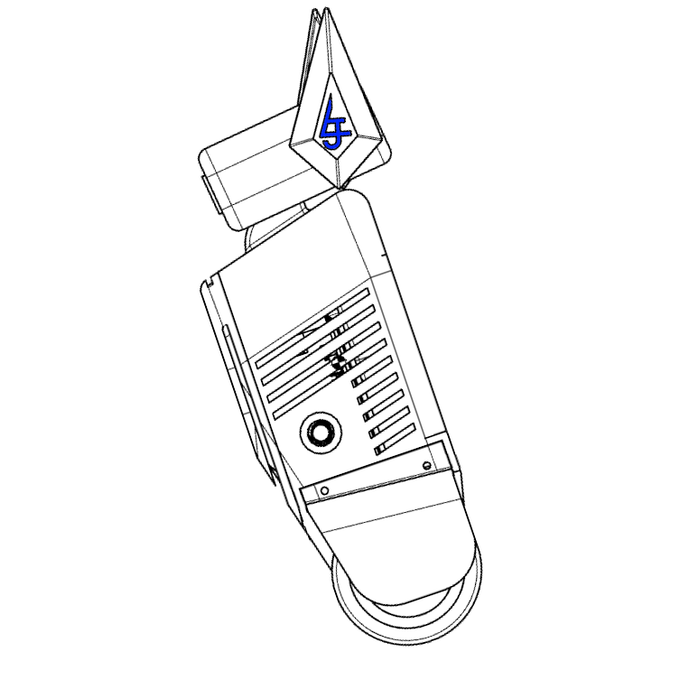

<!-- PROJECT SHIELDS -->
[![project_license][license-shield]][license-url]
[![Onshape][onshape-shield]][onshape-url]
[![LinkedIn][linkedin-shield]][linkedin-url]


# Balancer-V2 (B-V2)


## Repository Structure
```text
├── /firmware         # Control logic to run on Raspberry Pi OS
├── /hmi              # Frontend web HMI
├── LICENSE
└── README.md         📌 you are here

```

## Hardware Architecture & BOM (Bill of Materials)

### Core Electronic Components
* **Microcontroller:** Raspberry Pi 4B (8gb RAM)
* **IMU Sensor:** MPU6050 (6-Axis Accelerometer and Gyroscope)
* **Motors:** 12V 400 RPM Hobby Gearmotors
* **Driver:** TB6612FNG

### Pin Configuration Map
```text
To Be Determined
```

## Control Strategy

### Cascaded PID Balance Loop
Exact control strategy To Be Determined

---

## Getting Started & Setup

To Be Determined

---

## License & Acknowledgements
This repository is open-source under the terms of the [MIT License](LICENSE).
* Generative Artificial Intelligence was used to generate boilerplate code, brainstorm ideas, and troubleshoot technical issues during development. Every line of code in this repository has been human-audited and verified.
* HMI Icons provided by [Lucide Icons](https://lucide.dev)

<!-- MARKDOWN LINKS -->
[license-shield]: https://img.shields.io/github/license/liamjewer/BalancerV2.svg?style=for-the-badge
[license-url]: https://github.com
[linkedin-shield]: https://shields.io
[linkedin-url]: https://linkedin.com/in/liam-jewer-544b7915b
[onshape-shield]: https://shields.io
[onshape-url]: https://cad.onshape.com/documents/79de6c77069099a3c470ec91/w/1c2529a3ddeab6ff94d9cb8c/e/397ad8c1d4d84363a762f643?renderMode=0&uiState=6ad30d0d5b41021dfce36e15